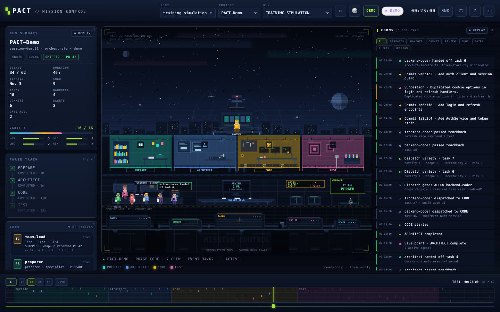

# PACT Mission Control



A local, read-only browser view of a PACT run. Mission Control reads the session
journals PACT already writes and renders them as a live control room: a phase
floor with the specialist crew at work, the dispatch and handoff flow, gates,
findings, reviews, and the full wrap-up debrief. Replay a finished run from
beginning to end, or watch a live session as its events land.

Everything runs on your machine. The server binds loopback only, the page makes
no external requests, and the viewer consumes no model or API tokens while it
runs.

## Two equal launch paths

The viewer is one Python server plus a static page. There are two equal ways to
start it — neither is a fallback for the other.

| | `/PACT:visualize` | Direct `bin/pact-viz` |
| --- | --- | --- |
| Runs from | a Claude Code session | your own shell |
| What it does | parses the argument, starts the server detached, optionally opens the browser, reports `URL:` and the stop command | starts the same server, foreground or detached |
| Token cost | one Claude turn (the command's work) | none |
| Best for | launching and stopping from inside a session | long replays, or keeping the viewer out of any session |

The command is a thin wrapper around the same binary. When in doubt, the direct
launcher is the simplest thing that can work.

## Quick launch

From a development clone of this repo:

```bash
# Foreground — blocks; Ctrl-C stops it.
pact-plugin/bin/pact-viz --demo --open

# Detached — prints "URL: ..." and returns. Stop it later with --stop.
pact-plugin/bin/pact-viz --demo --detach --open

# Real journals, newest run in the default config root.
pact-plugin/bin/pact-viz --open

# A specific project's newest run.
pact-plugin/bin/pact-viz --project PACT-prompt --open
```

From inside a Claude Code session, the command form does the same thing and
reports the URL back:

```
/PACT:visualize demo
/PACT:visualize my-app
/PACT:visualize stop
```

### Installed-cache symlink pattern

When PACT is installed as a plugin, the launcher lives inside the plugin cache
version directory — that version directory IS the plugin root, with `agents/`,
`bin/`, `commands/`, and `hooks/` directly inside it. Symlink the launcher once
onto your `PATH` so it is callable from anywhere:

```bash
ln -s "$HOME/.claude/plugins/cache/pact-plugin/PACT/<version>/bin/pact-viz" \
      "$HOME/.local/bin/pact-viz"

pact-viz --demo --open
```

The same pattern works for the `pact` launcher documented in the main README.
Re-point the symlink after a plugin upgrade if the version directory changes.

## Tokens and network

- **Zero runtime tokens.** The viewer is a Python server serving static files. It
  never calls a model, an API, or an external service, and it holds no API keys.
- **Command vs direct.** `/PACT:visualize` costs exactly one Claude turn — the
  turn that launches the server and reports the URL. The direct `bin/pact-viz`
  path involves no Claude turn at all, so it is token-free.
- **Loopback only.** The server binds `127.0.0.1` and has no remote-access or
  host-override flag. The page talks to the server over same-origin requests.
- **No telemetry.** No analytics, no crash reporting, no update pings, no CDN
  assets, no web fonts. The demo data is bundled with the plugin.
- **Read-only over your data.** The server never writes to journals, teams,
  tasks, or memory directories.

## What it reads

Pass one or more config roots; the tool resolves the root in this order:
`--root` (repeatable), then `$CLAUDE_CONFIG_DIR`, then `~/.claude`. Add
`--all-roots` to include sibling `~/.claude*` roots that contain a
`pact-sessions/` directory.

Under each root it reads:

| Source | What comes from it |
| --- | --- |
| `<root>/pact-sessions/<slug>/<session_id>/session-journal.jsonl` | The run itself: phase transitions, dispatches, handoffs, commits, reviews, findings, gates, alerts, checkpoints, wrap-up |
| `<root>/teams/<team>/config.json` | Team roster and teammate identities |
| `<root>/teams/<team>/pact-roster.jsonl` | Cloud roster intents, read when that team directory has no `config.json` |
| `<root>/tasks/<team>/*.json` | Task records, when present; journal cues fill the gaps |

Only exact journal paths at the depth above are discovered — nested scratch
journals are ignored. `pact-sessions/`, `teams/` and `tasks/` may be symlinks
themselves, but a symlink anywhere below them (a slug or session directory, a
journal, a team directory, or a file in it) is skipped, so every listed
session can be opened. Malformed or partial journal lines are skipped with a
warning rather than crashing the viewer.

The demo run (`--demo`) reads no journal at all: it is a deterministic scripted
run bundled with the plugin, available even on a machine with no PACT history.

## What you see, and which event drives it

The stage, the right-hand comms feed, the timeline, and the debrief all render
the same journal events. Roughly:

| Event type | Where it shows up |
| --- | --- |
| `phase` | Phase track and room transitions on the floor |
| `dispatch` | An agent walks into a room; a dispatch blip in the feed |
| `handoff` | Envelope arc across the floor; the six-field handoff record in the debrief |
| `commit` | Rocket effect with the short commit id; commit counter |
| `review` | Review marker on the deck; review entries in the debrief |
| `finding` / bug | Bug sprite and severity badge; findings tab of the debrief |
| `pr` | Pull-request badge in the run summary and debrief |
| `gate` | Gate turnstiles; allowed/advisory counts and top rules in the governance tab |
| `alert` | Siren and flash; alert entry in the feed. Fed by `algedonic_signal` and `blocker_raised` journal events; no current PACT writer emits those (algedonic signals travel as task metadata), so alerts are demo-only unless a journal carries the events |
| `checkpoint` | Save flag on the floor; phase-completion checkpoint |
| `session` | Start/end markers and the mission clock |
| `compact` | Screen wipe; context-compaction entry |
| `wake` | Auditor wake blip |
| `variety` | Variety gauge and radar reassessment |
| `task` | Task board updates in the debrief |
| anything unknown | Counted in the run's warnings and omitted from the feed and the raw log |

## Flags

| Flag | What it does |
| --- | --- |
| `--demo` | Serve the built-in deterministic training run (`?demo=1`); no journals needed |
| `--project <slug>` | Filter the session list to this project; its newest run opens |
| `--session <id>` | Filter the session list to sessions whose id contains this text |
| `--root <path>` | Read a config root (repeatable; default order above) |
| `--all-roots` | Also read sibling `~/.claude*` roots with `pact-sessions/` |
| `--port <n>` | Listen on a chosen loopback port instead of the tool's default |
| `--open` | Best-effort: open the viewer in the default browser after the server is up (the `URL:` line is still printed) |
| `--detach` | Start in the background, print the URL, and return only after a health check confirms it is reachable |
| `--stop` | Stop the detached instance recorded in the state file; idempotent |
| `--status` | Report whether a detached instance is running, with its URL, PID, and instance id |
| `--list` | List the sessions discovered in the selected roots as a plain-text table and exit |
| `--state-dir <path>` | Keep the detached-instance state file elsewhere |
| `--verbose` | More logging on stderr |
| `--version` | Print the version and exit |

Every successful launch prints exactly one `URL: ...` line on stdout, whether or
not `--open` was passed, so a headless session can report it without opening a
browser. `--detach` exits only once that URL passes a local health check, so the
URL it prints is immediately reachable, and it adds a `Stop: ...` hint naming the
command that closes the same instance. `--stop` prints one `Stop: ...` line:

- `Stop: stopped pid <pid>` — the health check confirmed the instance is gone;
  exit 0.
- `Stop: not running` — nothing healthy was running and any stale state file
  was removed; exit 0.
- `Stop: unconfirmed pid <pid>` — the process was signalled but did not confirm
  exit; the next line is `PACT Mission Control: stop was signalled but the process did not confirm exit`; exit 1.
- `Stop: refused` — the state file's pid does not match the pid in the running
  server's `/api/health` payload (a missing pid is refused too). Nothing is
  signalled, the next line names both pids, and the state file is deliberately
  kept: deleting the record would turn a recoverable mismatch into a server
  nothing can stop. Exit 1.

## Privacy

- **Local reads only.** The viewer reads local files under the roots you select.
  Nothing is uploaded, and nothing leaves the machine.
- **Read-only.** Mission Control never writes into `pact-sessions/`, `teams/`,
  `tasks/`, or `pact-memory/`. Its only write is its own small state file at
  `<config>/pact-viz/server.json` (directory `0700`, file `0600`), used to find
  and health-check a detached instance. `--stop` removes the instance; you may
  delete a stale state file by hand.
- **Single-user by design.** Loopback is reachable by any process or user on
  the machine, so anyone who can reach the port can read the journals the viewer
  serves and the `/api/health` instance token; there is no authentication. Run it
  on a single-user machine, and over SSH only through a tunnel you control.
- **Journal content is private.** The UI renders agent names, task subjects,
  handoff notes, and review text from your journals. Treat screenshots and shared
  URLs as containing the same information as the journals themselves.
- **Browser storage.** The page keeps UI preferences and per-session achievement
  progress in `localStorage`. There are no cookies, and no browser storage is
  read by the server.
- **Demo mode reads no real data.** `--demo` uses bundled fictional content and
  is safe to show on a call.

## Development and tests

Requires Python 3.12+ (the launcher checks and refuses older interpreters) and a
modern browser. No third-party Python packages, no build step, no Node toolchain
required for the runtime.

```bash
cd pact-plugin

# Backend, server, asset and command gates.
python3 -m pytest \
  tests/test_visualizer_data.py tests/test_visualizer_server.py \
  tests/test_visualizer_assets.py tests/test_visualizer_command.py -q

# Lint the backend for unused imports / undefined names.
ruff check --select F401,F821 --target-version py312 visualizer/

# Run the server directly from the checkout. -P keeps the current directory
# off the import path, so only the plugin's own package can load.
PYTHONPATH=. python3 -P -m visualizer --demo --open
```

The suite also runs a Python 3.12 syntax-floor scan and an unused-import sweep
over `visualizer/`, so keep the package stdlib-only and import-clean.

Front-end-only preview: serve `visualizer/static/` with any static file server
and open the page with `?mock=1` — the API layer then reads the bundled
`dev-demo.json` instead of calling the Python server. This is what front-end work
uses before the backend is wired up.

Directory shape:

```
visualizer/
  __init__.py __main__.py cli.py settings.py discovery.py journal.py
  roster.py classify.py model.py demo.py server.py
  CONTRACT.md README.md assets/hero.png
  static/  index.html favicon.svg dev-demo.json css/ js/
```

`CONTRACT.md` is the interface contract for the HTTP payloads, DOM shell, and JS
module boundaries. Change it before changing an interface.

## Remote sessions (SSH / EC2)

Run the viewer **on the machine that holds the journals** and forward its
loopback port. The server has no remote mode and no authentication; do not bind
it to a public interface or open the port in a cloud security group.

On the remote host (for example an EC2 instance running Claude Code):

```bash
cd ~/pact-mission-control
pact-plugin/bin/pact-viz --detach --port 8787
# URL: http://127.0.0.1:8787/
```

On the local machine:

```bash
ssh -N -L 8787:127.0.0.1:8787 <user>@<host>
# then open http://127.0.0.1:8787/ locally
```

If the remote Claude Code journals live under another user or
`CLAUDE_CONFIG_DIR`, pass `--root` explicitly. The remote host needs Python
3.12+; set `PACT_VIZ_PYTHON=/path/to/python3.12` when the default `python3` is
older. `/PACT:visualize` works on the remote host too: it starts the server
there and prints the URL; forward the port instead of expecting a browser on
the remote machine. VS Code Remote-SSH can forward the port from its Ports
panel.

For an offline copy, sync `~/.claude` locally and run with `--root`; a live
tunnel is the better path while the run is active.

## Troubleshooting

**No sessions listed.** The default root has no `pact-sessions/` journals, or
they live under a different config dir. Pass `--root <path>` or `--all-roots`,
or use `--demo` to confirm the viewer itself works.

**Nothing opens after a headless launch.** That is expected: `--open` is skipped
or unavailable over SSH and in display-less sessions. Read the printed `URL:`
line and forward the port, for example
`ssh -L <port>:127.0.0.1:<port> user@host`, then open the URL locally. Adding
`--open` on a machine with a browser is the only case where a window appears.

**Address already in use.** Choose another loopback port with `--port`, or stop
the old instance with `--stop` first. The tool reuses a healthy detached instance
rather than starting a second one, so a stale `--stop` is rarely needed. It
refuses to reuse one recorded by a different build version, root set, port,
launch mode, or filter — stop that instance first; a record with no readable
version is reported as `(unknown)` and refused too.

**`--stop` reports no running instance.** `Stop: not running` is success, not an
error: no healthy detached instance was found, and any stale state file was
removed. Check `--status` if you expected one to be up; `--detach` starts a fresh
instance.

**`bin/pact-viz: permission denied`.** The launcher must be executable:
`chmod +x pact-plugin/bin/pact-viz`, or run it as `bash pact-plugin/bin/pact-viz`.
Symlink installs keep the target's mode.

**`python3` is too old.** Mission Control requires Python 3.12+; the launcher
checks and prints the interpreter it found. Point `python3` at a 3.12+
interpreter, or set `PACT_VIZ_PYTHON=/path/to/python3.12` and run the launcher
again.

**Blank page.** Open the URL the server prints, not the static files over
`file://` — the page is an ES-module app and needs the local HTTP server. The
bundled demo data also expects a server context.

**Live view is not moving.** Only live runs poll for new events; a finished
session is static by design. Use the timeline transport to replay it, or return
to the live badge for an in-progress run. Sound stays silent until you toggle
`SND` (browser autoplay rules require a click).

**Hero image missing after a fresh checkout.** `assets/hero.png` is a captured
screenshot of the running viewer; rebuild it by screenshotting the demo, or pull
the tracked asset from the repo. The asset test requires it to exist and stay
under 2 MB.
